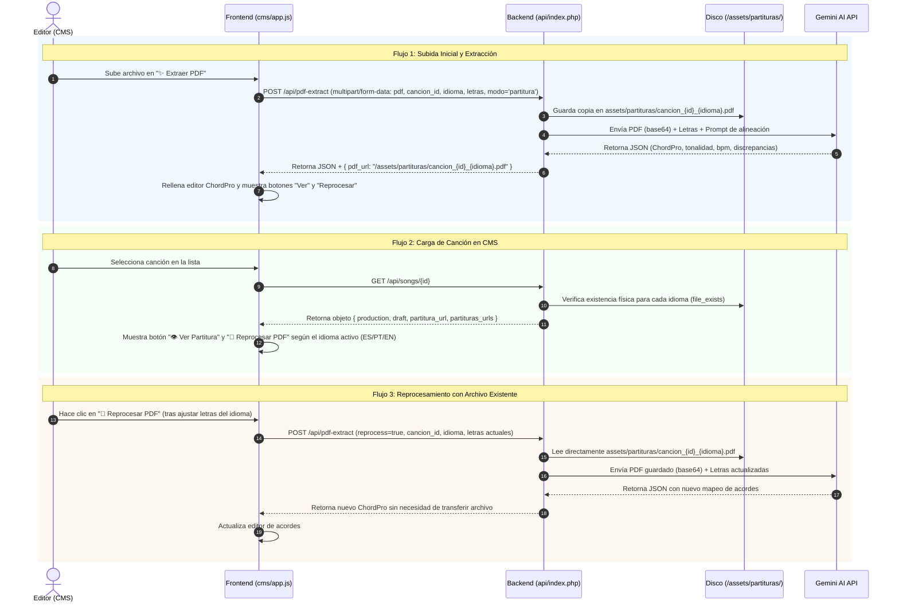

# Arquitectura y Almacenamiento de Partituras PDF en La Lira

Este documento describe la arquitectura, flujo de datos y funcionamiento del almacenamiento de archivos PDF (partituras musicales) en el sistema La Lira (CMS y API), sirviendo como referencia técnica para futuras sesiones de desarrollo y mantenimiento.

---

## 1. Visión General

El CMS de La Lira permite a los editores subir partituras musicales oficiales en formato PDF para:
1. **Extracción y alineación asistida por Inteligencia Artificial (Gemini):** Analizar notas musicales, tonalidad, BPM, compás, ritmo y alinear los acordes resultantes (ChordPro) con la letra canónica de la canción en el idioma activo (`es`, `pt`, `en`).
2. **Almacenamiento persistente en el servidor:** Guardar el documento PDF para consulta futura por parte de los editores y músicos, diferenciado por idioma.
3. **Reprocesamiento bajo demanda:** Volver a ejecutar el análisis de acordes usando el PDF ya guardado sin requerir que el usuario vuelva a subir el archivo desde su equipo local.

---

## 2. Almacenamiento Físico y Nombres de Archivo

A diferencia de la metadata de las canciones y los borradores (que se gestionan en bases de datos SQLite), los archivos binarios PDF se almacenan directamente en el **sistema de archivos del servidor web**:

* **Ruta en el servidor:** 
  ```text
  assets/partituras/
  ```
  *(En entornos de producción corresponde a `{DOCROOT}/assets/partituras/`)*.
* **Convención de nomenclatura:**
  ```text
  cancion_{cancion_id}_{idioma}.pdf
  ```
  Donde `{cancion_id}` es sanitizado para permitir únicamente caracteres alfanuméricos, guiones y guiones bajos (`preg_replace('/[^a-zA-Z0-9_-]/', '', $cancionId)`) e `{idioma}` es el código del idioma (`es`, `pt`, `en`).
  * Ejemplo para la canción ID `142` en español: `assets/partituras/cancion_142_es.pdf` (manteniendo copia de retrocompatibilidad `cancion_142.pdf`).
  * Ejemplo para la canción ID `142` en portugués: `assets/partituras/cancion_142_pt.pdf`.
  * URL pública / interna servida por el servidor web: `/assets/partituras/cancion_142_es.pdf`
* **Canciones temporales o no guardadas:** Si se sube una partitura para una canción que aún no tiene ID definido, se nombra temporalmente `cancion_temp_{idioma}.pdf` o `cancion_temp.pdf`.

> [!NOTE]
> **¿Por qué en el sistema de archivos y no en SQLite?**
> La base de datos `catalogo_v2.sqlite` se distribuye a las aplicaciones móviles y clientes web, por lo que debe mantenerse compacta y ligera. Mantener los archivos binarios PDF en el sistema de archivos permite servirlos estáticamente a través de Apache/Nginx con caché nativo, sin inflar el tamaño de la base de datos de producción.

---

## 3. Flujo de Trabajo y Ciclo de Vida



---

## 4. Endpoints y Lógica de Negocio

### A. `POST /api/pdf-extract`
* **Ubicación del código:** `api/index.php`
* **Autenticación:** Requiere Bearer Token JWT de sesión activa (`require_auth()`).
* **Parámetros recibidos (FormData):**
  * `pdf` *(File, opcional si `reprocess=true`)*: Archivo binario de la partitura.
  * `cancion_id` *(String/Int)*: ID numérico de la canción.
  * `idioma` *(String, opcional)*: Código de idioma (`es`, `pt`, `en`). Si no se especifica, por defecto es `es`.
  * `modo` *(String)*: `'partitura'` o `'cifrado'`.
  * `letras` *(String)*: Texto plano de las estrofas actuales para anclar las sílabas a los acordes.
  * `reprocess` *(Boolean, opcional)*: Si es `'true'`, el servidor reutiliza el archivo existente en disco en lugar de requerir `$_FILES['pdf']`.
* **Comportamiento:**
  1. Si `reprocess === true`:
     * Busca `$destPath = assets/partituras/cancion_{id}_{idioma}.pdf` (con fallback a `cancion_{id}.pdf`).
     * Si no existe, devuelve HTTP `404: No se encontró una partitura previa guardada para esta canción`.
     * Lee el archivo local directamente con `file_get_contents` y lo codifica en Base64.
  2. Si `reprocess === false`:
     * Valida que `$_FILES['pdf']` haya llegado sin errores.
     * Codifica el archivo temporal a Base64.
     * Si `modo === 'partitura'`, crea el directorio si no existe y ejecuta `move_uploaded_file` hacia `$destPath`. Si el idioma es `es`, genera además la copia de compatibilidad `cancion_{id}.pdf`.
  3. Ejecuta la llamada a Gemini AI (`models/gemini-3.8-flash` o fallback).
  4. Responde con el resultado JSON estructurado, agregando `pdf_url: '/assets/partituras/' . $fileName`.

### B. `POST /api/pdf-upload`
* **Ubicación del código:** `api/index.php`
* **Autenticación:** Requiere Bearer Token JWT de sesión activa (`require_auth()`).
* **Propósito:** Almacenar la partitura en el servidor vinculada a la canción (`assets/partituras/cancion_{id}_{idioma}.pdf`) de forma instantánea **sin consumir IA ni procesar acordes**.
* **Parámetros recibidos (FormData):**
  * `pdf` *(File)*: Archivo binario de la partitura.
  * `cancion_id` *(String/Int)*: ID numérico de la canción.
  * `idioma` *(String, opcional)*: Código de idioma (`es`, `pt`, `en`).
* **Comportamiento:**
  1. Valida autenticación y que el archivo sea un PDF (`application/pdf`).
  2. Guarda el archivo directamente en `assets/partituras/cancion_{id}_{idioma}.pdf` (y copia a `cancion_{id}.pdf` si es `es`).
  3. Responde inmediatamente con `{ "success": true, "pdf_url": "/assets/partituras/cancion_{id}_{idioma}.pdf" }`.
  4. En el CMS, activa de inmediato `👁️ Ver Partitura` y `🔄 Reprocesar PDF` para la pestaña del idioma actual.

### C. `GET /api/songs/{id}`
* **Ubicación del código:** `api/index.php`
* **Resolución dinámica:**
  Escanea los archivos físicos para cada idioma (`es`, `pt`, `en`):
  Retorna `partituras_urls: { es: '/assets/partituras/cancion_{id}_es.pdf', pt: '/assets/partituras/cancion_{id}_pt.pdf' }` y `partitura_url` (idioma activo o fallback).

---

## 5. Diferencia entre "Modo Partitura" y "Modo Cifrado"

En la interfaz del editor de acordes existen dos opciones con IA:

| Característica | Modo Partitura (`modo: 'partitura'`) | Modo Cifrado (`modo: 'cifrado'`) |
| :--- | :--- | :--- |
| **Botón en interfaz** | `✨ Extraer PDF` / `🔄 Reprocesar PDF` | `📸 Extraer Cifrado` |
| **Tipo de entrada** | Documento PDF formal con pentagrama | Imagen o PDF de cifrado informal (acordes sobre letra) |
| **Almacenamiento en disco** | **Sí**, persistente en `assets/partituras/cancion_{id}_{idioma}.pdf` | **No** (archivo efímero en `/tmp`, no se guarda) |
| **Botón de visualización** | Activa `👁️ Ver Partitura` para el idioma seleccionado | No aplica |
| **Capacidad de reproceso** | **Sí**, mediante el archivo guardado en ese idioma | No (requiere volver a adjuntar o pegar del portapapeles) |

---

## 6. Mantenimiento y Operaciones (Checklist para el Servidor)

1. **Permisos de escritura en producción:**
   Asegurar que el usuario de PHP (`nobody`, `www-data` o el usuario cPanel `magnusal`) tenga permisos de escritura:
   ```bash
   chmod 755 /home3/magnusal/public_html/lalira/assets/partituras
   ```
2. **Copias de seguridad y migración:**
   Dado que las partituras residen en el sistema de archivos y no dentro de los archivos `.sqlite`, al clonar o migrar el catálogo de un entorno a otro se debe sincronizar la carpeta de partituras:
   ```bash
   # Descargar partituras de producción a local
   rsync -avz magnusal@maranata.org:/home3/magnusal/public_html/lalira/assets/partituras/ ./assets/partituras/
   ```
3. **Persistencia tras la publicación:**
   Al publicar un borrador a través de `catalog_publisher.php`, los datos de texto y acordes se consolidan en `catalogo_v2.sqlite`. El manifiesto `version_v2.json` indexa las partituras tanto con sufijo de idioma (`100097_es`, `100097_pt`) como sin sufijo (`100097`) para retrocompatibilidad total.
